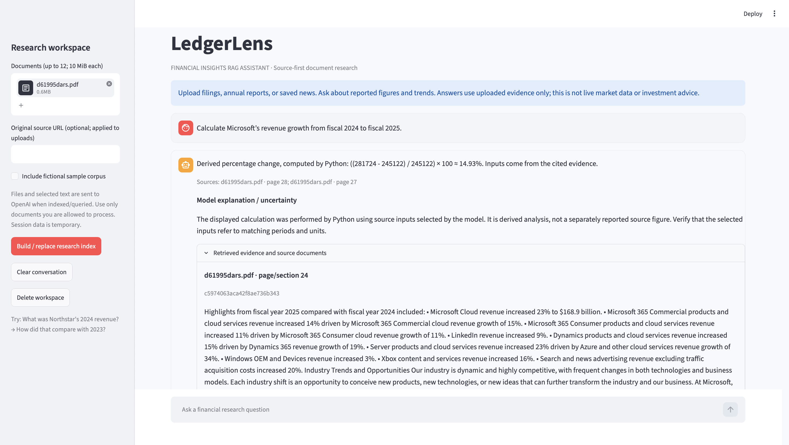
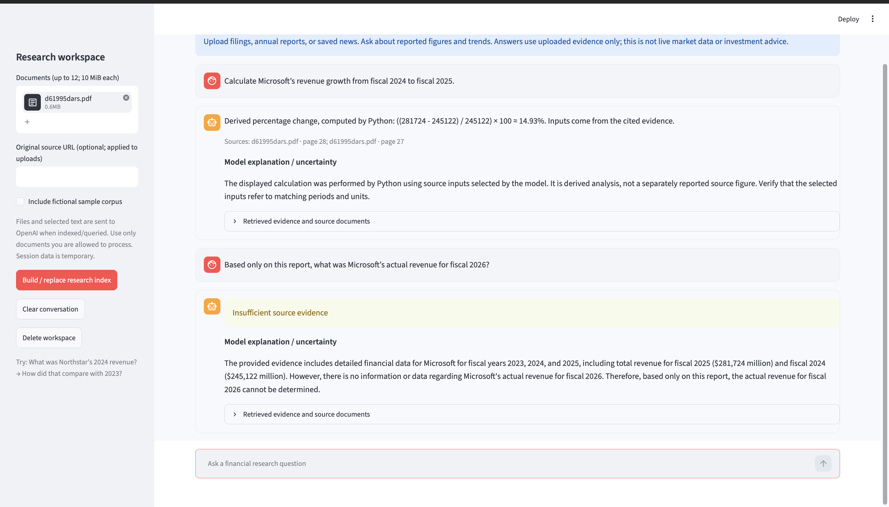
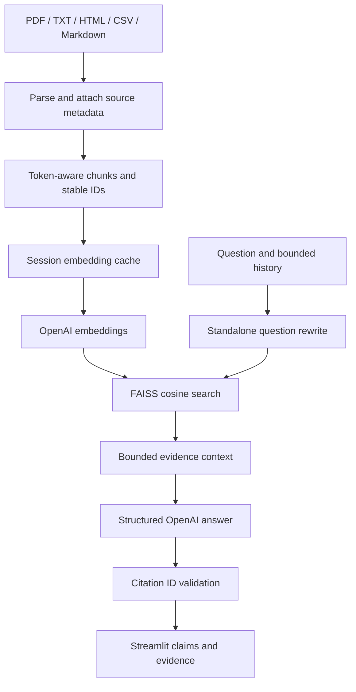

# Financial Insights RAG Assistant · LedgerLens

A source-first financial research application built with Python, LangChain's OpenAI integration, FAISS, and Streamlit. Upload annual reports, SEC filing documents, or saved news; inspect retrieved evidence alongside conversational answers.

**Status:** implemented and privately deployed to Google Cloud Run. 29 automated tests pass locally. Docker and cloud smoke tests cover document retrieval, conversational follow-ups, Python-calculated growth, and unsupported-answer refusal. See `reports/VALIDATION.md` for evidence and evaluation limits.


## Screenshots

### Revenue growth calculated by Python


### Refusal when evidence is missing


## Architecture



`ingestion.py` parses, cleans and chunks documents; `embeddings.py` wraps the LangChain OpenAI client and cache; `retrieval.py` manages normalized FAISS vectors; `generation.py` budgets history/evidence, rewrites follow-ups and validates structured citations; `app.py` owns session UI only. `config.py` defines settings and safe errors. `scripts/evaluate.py` runs document-level retrieval evaluation and optionally saves answer/evidence pairs for review.

## macOS setup (including Apple Silicon)

Install Python 3.12 using python.org or `brew install python@3.12`. From the extracted project folder:

```bash
python3.12 -m venv .venv
source .venv/bin/activate
python -m pip install --upgrade pip
python -m pip install -r requirements.txt
python -m pip install -e . --no-deps
cp .env.example .env
```

Edit `.env` locally to set **your own OpenAI API key**. Never commit it or paste it into chat. ChatGPT subscriptions do not supply application API credits. The model names are configurable; access must be verified in your account. Dependencies are pinned to the versions resolved and installed in the supplied validation environment; local macOS execution and Docker operation were subsequently validated. If FAISS has no wheel for your Python/platform, use Python 3.12 and the Docker path rather than silently substituting another retriever.

```bash
pytest -q
python scripts/evaluate.py --mode offline --output reports/offline.json
python -m streamlit run app.py
```

Open http://localhost:8501. Click **Build / replace research index** with the sample checkbox enabled. Ask “What was Northstar's 2024 revenue?” then “How did that compare with 2023?” The fictional fixture reports USD 120 million and USD 100 million respectively. A 20% change is a derived calculation `(120-100)/100*100`, not a separately reported source value. Ask “What is its 2025 revenue forecast?” and verify abstention. Inspect source evidence, download citations, then upload a real public report and repeat.

Supported: text PDFs, UTF-8 TXT/MD, HTML, CSV. HTML/news ingestion is **saved-file upload**, not crawling. Download an issuer's report or SEC filing as PDF/HTML, upload it, and attach its original URL. No automated SEC requests, market feed, OCR, paywall bypass, or live news connector is included. CSV rows are serialized as text, not executed as analytical queries. PDF tables may extract poorly.

## Sources and grounding

Each chunk retains filename, content-derived document ID, page, source URL, and stable chunk ID. The UI shows claim citations plus the corresponding excerpts and document downloads, and an external source button when a URL was supplied. URLs are provenance annotations supplied by the uploader; they are not authenticated against document bytes. Filenames and evidence are displayed as data; no arbitrary HTML is rendered from uploads.

The generation prompt restricts factual claims to evidence, preserves currency/period/units, requests abstention, and treats embedded instructions as untrusted. Structured output requires citations per claim; runtime validation rejects nonexistent chunk IDs. **This validates attribution structure, not entailment.** A model can still misread a table, cite an irrelevant passage, or invent an explanation. Human grounding evaluation is mandatory before claiming answer quality.

## Resource, privacy, and reliability choices

- Session-local indexes/cache isolate browser sessions; no globally cached private documents. No authentication or durable user accounts are included.
- Explicit submit controls avoid embedding on each Streamlit rerun. Identical text embeddings are reused within the session; new questions are embedded once. Follow-ups cost an additional rewrite call.
- 12 files, 10 MiB/file, 1,500 chunks, 450-token chunks, 70-token overlap, top 5 retrieval. History is bounded to 1,800 tokens, evidence to 5,000, question to 600, answer to 1,000 output tokens. Metadata is included in evidence budget. These caps reserve headroom for prompt/schema overhead; verify the configured model supports at least a 16K context.
- Embeddings use batches of 8, a 60-second timeout, and up to 6 SDK retries. Chat requests use a 45-second timeout and up to 2 SDK retries. Errors show generic guidance; logs include exception class only. No automatic infinite retry or provider error payload logging.
- Exact normalized FAISS inner product is transparent and appropriate for a bounded corpus; approximate indexes add complexity with no demonstrated need here. No pickle deserialization.
- No relevance cutoff is claimed: cosine values are model/corpus dependent. Non-answerability is determined by the prompted model and reviewed in evaluation.
- Uploaded files and excerpts leave the app for OpenAI processing. A public unauthenticated deployment can incur API charges. Keep Cloud Run private for initial testing; add application authentication and enforce per-user quotas before offering a public demo.

## Calculator and demo access

Revenue-growth arithmetic uses Python Decimal after the model selects inputs.
Validation accepts literal cited numbers or consistently scaled values with
explicit thousand/million/billion/trillion labels. Mixed scales are rejected.
This does not prove the selected numbers belong to matching companies,
periods, currencies, or financial measures; inspect the cited evidence.

Cloud Run is deployed privately. The public repository and screenshots provide
the portfolio demonstration. Opening the cloud service requires authorized
access; the service URL is not a public demo.

## Tests and evaluation

```bash
pytest -q
python scripts/evaluate.py --mode offline --k 3 --output reports/offline.json
# Requires your API key and incurs charges:
python scripts/evaluate.py --mode openai --k 3 --answers --output reports/live-openai.json
```

The four-question fixture is intentionally tiny and fictional. Offline mode uses deterministic keyword embeddings to test FAISS plumbing and metrics; it is not an OpenAI quality benchmark. `Recall@K` measures the fraction of relevant documents retrieved among the top K chunks; duplicate documents collapse for reciprocal rank. MRR uses the rank of the first relevant unique document. Reports include this definition. The unanswerable question still has a relevant document explicitly saying no forecast is supplied. No retrieval relevance labels imply that the model can answer other absent information.

See `docs/EVALUATION.md` for human grounded-answer scoring and a real-document expansion protocol. Do not put offline results on a resume as semantic retrieval accuracy.

## Docker

```bash
docker build -t financial-rag .
docker run --rm -p 8080:8080 --env-file .env financial-rag
curl -f http://localhost:8080/_stcore/health
```

On an M3 Mac, validate the local ARM image. For Cloud Run use Cloud Build (remote Linux build) in `docs/DEPLOYMENT.md`, or build an amd64 image explicitly. The process runs as a non-root user and honors `PORT`. No API key is baked into the image.

## Deploy, screenshots, and GitHub

Follow `docs/DEPLOYMENT.md` for Secret Manager, dedicated runtime identity, Cloud Run commands, persistence options, validation, and teardown. Follow `docs/PUBLISH.md` for a screenshot checklist and GitHub publication. Deployment is not complete until the deployed URL has been tested with real API requests.

## Limitations and future improvements

This is a bounded portfolio implementation, not a regulated investment platform. No live financial feed, OCR, robust table parser, general-purpose financial calculation engine, reranker, automated entailment verifier, authentication, per-user billing, or durable chat/index storage. Docker, macOS execution, and private Cloud Run smoke checks were completed separately. Broad live-model quality has not been established. Streamlit reconnects and instance changes can lose sessions. Large or malicious PDFs may consume parsing resources despite byte limits; production uploads need isolated workers and document/page/time quotas. Caches are session-local and bounded indirectly by the corpus limit but repeated corpus replacement can grow the cache: delete workspace to release it.

Next improvements should follow measured failures: real-document evaluation, structured table extraction/calculations, calibrated retrieval refusal, authenticated sessions, quotas, durable immutable indexes, and monitoring. Avoid adding agents or distributed infrastructure without a demonstrated use case.

## Interview explanation

Explain: why exact FAISS cosine search; why history is rewritten rather than treated as evidence; how stable chunk IDs connect claims to sources; what citation checks cannot prove; why Cloud Run session data is temporary; and how a real evaluation differs from a deterministic fixture.
